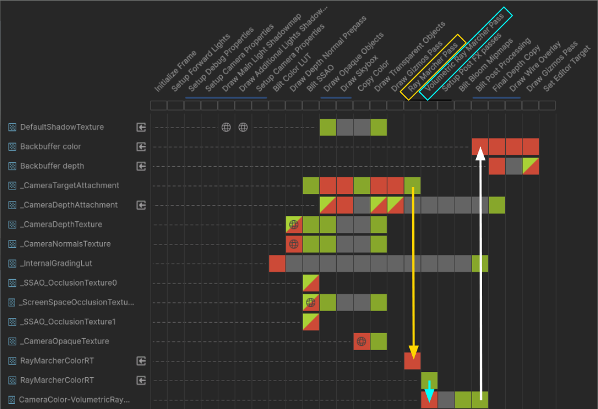
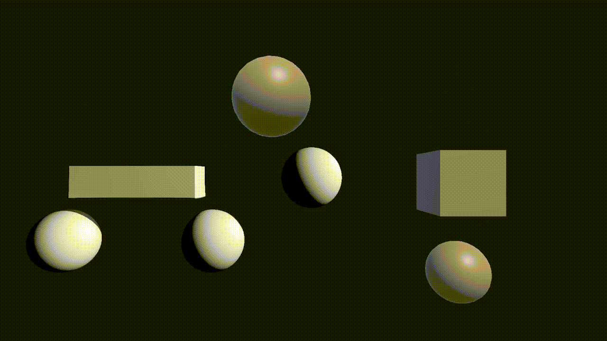
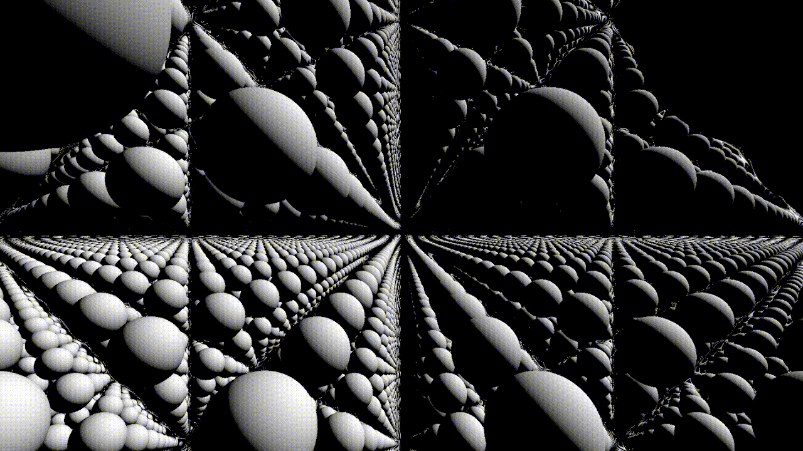
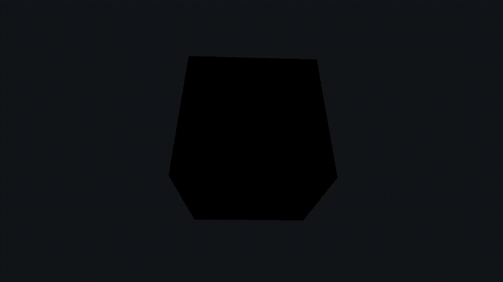
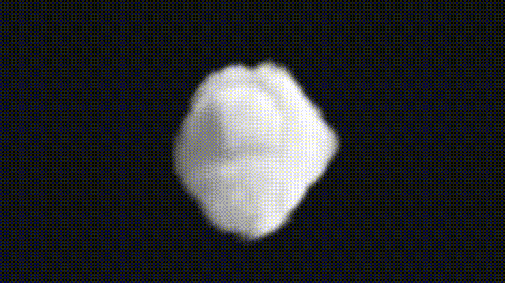

# Unity Ray Marcher

## Description

A real-time ray marcher for Unity's Universal Render Pipeline. Primitives, smooth blending, fractals and volumetric clouds rendered through a custom render feature.

Project created to become familiar with the Unity URP pipeline and rendering effects derived from ray marching.

## Features

- Basic primitives rendered through ray marching
- Spatial operations for ray marched objects with configurable smoothing
  - Smooth union
  - Smooth subtraction
  - Smooth intersection
- Space repetition of the whole scene through cells with configurable dimensions
- Fractals (Menger sponge) built through iterative space repetition
- Ray marched volumetric clouds
- Editor integration for configuring ray marched objects

## Ray Marcher Manager

Scene component that collects the information of every ray marched object in the scene. Objects register themselves in the manager and are grouped by operation type, with clouds kept in their own list. The render feature reads these lists to populate the buffers of the shaders.

It is also where the scene-wide settings are configured:

- **Light source:** the point light that affects the ray marched objects and the clouds.
- **K value:** the smoothness of the object operations (see [Operations](#operations)).
- **Space repetition:** enables the repetition of the scene through cells, and sets the dimensions of those cells.
- **Cloud parameters:** the parameters shared by all clouds (see [Volumetric Ray Marched Objects](#volumetric-ray-marched-objects)).

## Ray Marched Objects

Objects that use SDF operations to render them into the scene. Each object's position can be changed in the editor. Their `Vector3` `size` is used throughout all rm objects with different applications.

### Primitives

- **Sphere**
  - `Size.x`: radius
- **Cube**
  - `Size.xyz`: half of the cube's side length on each axis
- **Menger Sponge**
  - `Size.x`: Menger sponge's side length
  - `Size.y`: number of fractal iterations

### Operations

Each object has an operation type that defines how it combines with the rest of the scene. Objects without an operation are rendered as they are, without any effect. The rest of the objects are grouped by operation:

- **Smooth union:** the objects of this group are blended together into a single smooth shape.
- **Smooth subtraction:** the objects of this group are carved out of the volume of the smooth union objects. It only affects smooth union objects, so with none in the scene it has no visible effect.
- **Smooth intersection:** only the volume shared by all the objects of this group is rendered.

The degree of smoothness of these operations is configurable through the **K value** in the Ray Marcher Manager, and it is shared by all of them. Lower values give a softer and wider blend, while higher values get closer to a sharp, non-smoothed operation.

## Volumetric Ray Marched Objects

Objects that are rendered by sampling a volume through ray marching. All clouds share common parameters that can be set from the Ray Marcher Manager.

- **Cloud**
  - `Size.xyz`: dimensions of the cloud's bounding box, the volume that is sampled
  - **Step size:** distance between samples as the view ray travels through a cloud. Smaller values give more detail but cost more, and since the number of steps is fixed, a smaller step also shortens how deep the ray can reach into the volume.
  - **Density scale:** multiplier applied to the density read from the 3D texture. Higher values make clouds thicker and more opaque.
  - **Light step size:** distance between samples of the secondary ray marched towards the light. It controls how far into the cloud the self-shadowing looks.
  - **Light absorb:** how quickly light is absorbed as it passes through dense areas. Higher values make clouds darker and hide whatever is behind them sooner.
  - **Darkness threshold:** minimum brightness left in shadowed areas. At 0 the shadows are fully dark, and at 1 there are no shadows.
  - **Transmittance:** starting amount of light carried by the view ray when it enters a cloud. Lower values make the whole cloud dimmer and let the ray stop earlier.

## Unity integration

### Render passes

Two passes are injected into the Unity URP through the use of a Custom Render Feature.

The injection point of both passes is configurable from the render feature (`Injection Point`), and by default it is `AfterRenderingPostProcessing`.

- **Ray Marcher Pass:** blits the Camera Target Attachment into an intermediate texture and renders the SDF scene on top of it, checking depth in the process. Iterates through the ray marched object list given by the Ray Marcher Manager and performs their SDF operations. The final color of the pixel is stored in the RGB channels of the texture, and its depth in the alpha channel so it can be compared against in the next pass.
- **Volumetric Ray Marcher Pass:** performs ray marching through cloud volumes. Uses the texture from the previous pass and renders the clouds on top of it, checking against its alpha channel for depth.

### Editor

- A new section in the right-click menu of the Hierarchy (`GameObject > Ray Marching`) creates the Ray Marcher Manager and every type of ray marched object (sphere, box, Menger sponge and cloud) directly in the scene.
- In the editor, the objects are represented by gizmos that draw their shape and bounds, which can be toggled per object.
- Their positions can be changed like any other GameObject, and the gizmos follow them.

## Examples

### Smooth union, subtraction and blending

### Space repetition

### Menger Sponge

### Volumetric Clouds

